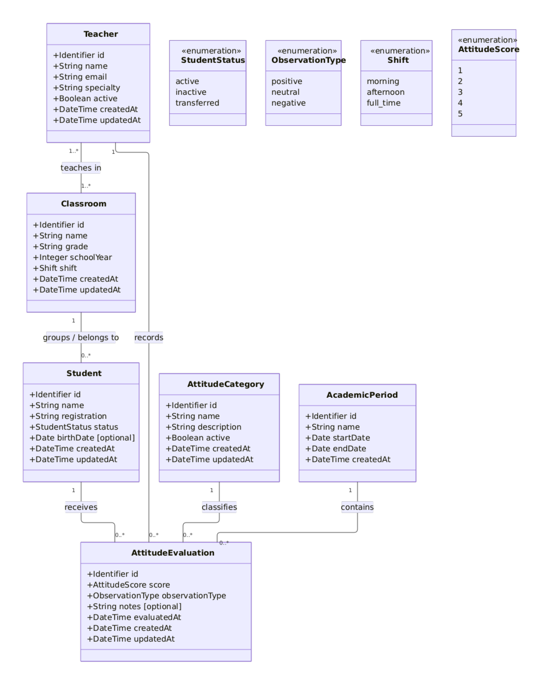
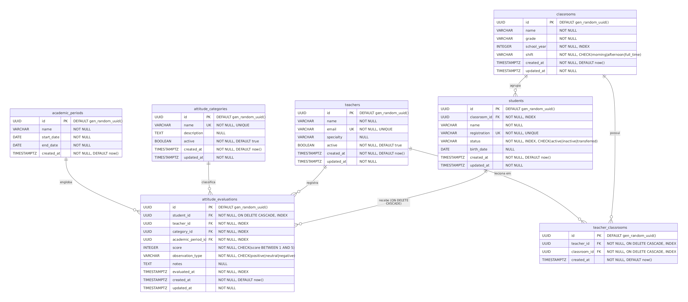

# Sistema Web para Avaliação Atitudinal

**Marco de Produção: Modelo de Domínio e Interface Mock**

Aplicação web desenvolvida em Next.js (App Router) e TypeScript estrito para apoiar o acompanhamento contínuo de competências atitudinais no ensino fundamental. O escopo modelado pela equipe adota o **registro contínuo por ocorrência** tendo o **estudante** (`Student`) como entidade central: professores vinculados às suas turmas registram avaliações atitudinais em períodos letivos definidos, classificando cada observação por dimensão atitudinal, escala numérica (`1` a `5`), natureza da observação (`positive`, `neutral`, `negative`) e notas qualitativas opcionais.

## Integrantes da equipe

- João Gabriel do Carmo Brito
- Bruno Henrique Nogueira
- Bernardo Oliveira Santos

---

## Requisitos e instruções de execução

### Versões esperadas do ambiente

- **Node.js:** `v24.19.0` LTS (`v24.x`)
- **npm:** `11.17.0` (`11.x`)

Verifique antes de iniciar:

```bash
node --version
npm --version
```

### Instalação e execução

```bash
# 1. Instalar dependências
npm install

# 2. Iniciar o servidor de desenvolvimento (Turbopack)
npm run dev
```

Após iniciar o servidor, abra no navegador:

- Interface mock de listagem de estudantes: [http://localhost:3000/lab/students](http://localhost:3000/lab/students)

### Scripts de verificação

```bash
# Checagem estática de tipos (TypeScript estrito)
npx tsc --noEmit

# Verificação de regras do ESLint
npm run lint

# Verificação de formatação (Prettier + Tailwind)
npm run format:check

# Build de produção
npm run build
```

### Verificação manual dos quatro estados da página

1. **Carregamento:** ao abrir `/lab/students`, a mensagem `Carregando estudantes...` (`role="status"`) aparece por cerca de `750 ms` devido ao atraso simulado em `listStudents()`.
2. **Sucesso:** ao finalizar o carregamento padrão, são exibidos os 15 cartões de estudantes fictícios nos três status (`Ativo`, `Inativo` e `Transferido`).
3. **Vazio:** substituindo temporariamente o retorno de `listStudents()` por `[]` (ou esvaziando `MOCK_STUDENTS`), a página exibe `Nenhum estudante cadastrado no momento.` (`role="status"`).
4. **Erro:** removendo ou invalidando qualquer campo obrigatório de um estudante no mock, `hasValidStudentFields` detecta a inconsistência e renderiza o alerta `Erro ao carregar estudantes` (`role="alert"`).

---

## Árvore de arquivos produzidos

```text
tcd1/
├── .github/
│   └── workflows/                     # Pipelines futuros de CI/CD (Cap. 16 e 17)
├── public/
│   ├── uml.png                        # Artefato 1: Diagrama de Classes UML (2061x2612 px)
│   └── der.png                        # Artefato 2: Diagrama Entidade-Relacionamento DER (3217x1414 px)
├── src/
│   ├── app/
│   │   ├── lab/
│   │   │   └── students/
│   │   │       └── page.tsx           # Artefato 7: Página StudentsPage (/lab/students) com 4 estados
│   │   ├── globals.css                # Folha de estilos global CSS-first do Tailwind CSS 4
│   │   ├── layout.tsx                 # Layout raiz da aplicação App Router
│   │   └── page.tsx                   # Página inicial padrão do template Next.js
│   ├── components/
│   │   ├── forms/                     # Diretório reservado para componentes de formulário
│   │   ├── students/
│   │   │   └── student-card.tsx       # Artefato 6: Componente de apresentação StudentCard
│   │   ├── theme/                     # Diretório reservado para alternância de tema
│   │   └── ui/                        # Diretório reservado para componentes genéricos de UI
│   ├── lib/
│   │   ├── actions/                   # Diretório reservado para Server Actions (Cap. 10 e 14)
│   │   ├── data/
│   │   │   ├── students.ts            # Artefato 4: Array readonly MOCK_STUDENTS (15 registros fictícios)
│   │   │   └── index.ts               # Artefato 5: Consultas mock async listStudents e getStudent
│   │   ├── domain/                    # Diretório reservado para funções puras de domínio
│   │   ├── hooks/                     # Diretório reservado para custom hooks
│   │   ├── storage/                   # Diretório reservado para helpers de Storage (Cap. 11)
│   │   ├── supabase/                  # Diretório reservado para clientes Supabase (Cap. 9)
│   │   ├── theme/                     # Diretório reservado para ThemeProvider e useTheme (Cap. 5)
│   │   ├── utils/                     # Diretório reservado para utilitários compartilhados
│   │   └── validation/                # Diretório reservado para schemas Zod (Cap. 13)
│   └── types/
│       └── domain.ts                  # Artefato 3: Fonte da verdade dos tipos do domínio e ActionResult<T>
├── supabase/
│   ├── migrations/                    # Diretório reservado para migrações SQL (Cap. 8)
│   ├── seeds/                         # Diretório reservado para dados de seed (Cap. 8)
│   └── tests/rls/                     # Diretório reservado para testes de RLS (Cap. 11)
├── .env.example                       # Modelo de variáveis de ambiente públicas para integração futura
├── .gitignore                         # Regras de arquivos ignorados pelo Git
├── .prettierignore                    # Arquivos e pastas ignorados pelo Prettier
├── .prettierrc                        # Configuração de formatação Prettier + ordenação Tailwind
├── eslint.config.mjs                  # Configuração flat do ESLint 9 com presets do Next.js
├── next.config.ts                     # Configuração do Next.js 16.4 com Turbopack
├── package.json                       # Manifesto do projeto, scripts e dependências
├── tsconfig.json                      # Configuração do compilador TypeScript em modo strict
└── README.md                          # Documentação operacional e justificativas do marco
```

---

## Decisões de modelagem e implementação

### Artefato 1 — Diagrama de Classes (UML)



- **Centralidade de `Student`:** todas as associações operacionais convergem para o estudante (`Classroom 1 ── 0..* Student` e `Student 1 ── 0..* AttitudeEvaluation`), permitindo que a interface e o restante do sistema se organizem a partir dele.
- **Separação das entidades do domínio:** `Teacher`, `Classroom`, `AttitudeCategory`, `AcademicPeriod` e `AttitudeEvaluation` separam quem leciona/avalia, onde o estudante está matriculado, quais dimensões socioemocionais estão ativas, em qual janela temporal ocorre o registro e o evento granular de avaliação.
- **Cardinalidades e multiplicidades explícitas:** `Teacher 1..* ── 1..* Classroom` reflete que docentes atuam em múltiplas turmas e uma turma possui vários docentes; `Classroom 1 ── 0..* Student` permite criar turmas antes da enturmação; `Student`, `Teacher`, `AttitudeCategory` e `AcademicPeriod` ligam-se em `1` para `0..*` com `AttitudeEvaluation` para preservar histórico granular de ocorrências.
- **Campos opcionais e enumerações:** `birthDate` em `Student` e `notes` em `AttitudeEvaluation` são opcionais porque nem sempre a data civil está disponível no cadastro inicial ou o registro rápido em sala exige texto livre; `StudentStatus`, `ObservationType`, `Shift` e `AttitudeScore` foram modelados como `«enumeration»` agnósticas de banco ou framework.

### Artefato 2 — Diagrama Entidade-Relacionamento (DER)



- **Identificadores e temporização:** todas as tabelas utilizam `id UUID PRIMARY KEY DEFAULT gen_random_uuid()` para evitar exposição de ordem sequencial em URLs, e `created_at TIMESTAMPTZ NOT NULL DEFAULT now()` para registro com fuso horário. Tabelas mutáveis mantêm `updated_at TIMESTAMPTZ NOT NULL`; `academic_periods` e `teacher_classrooms` omitem `updated_at` por representarem registros imutáveis de intervalo/vínculo.
- **Materialização N-M e integridade referencial:** a associação `Teacher 1..* ── 1..* Classroom` do UML tornou-se a tabela associativa `teacher_classrooms` com `teacher_id` e `classroom_id` sob `ON DELETE CASCADE`. Em `attitude_evaluations`, `student_id` usa `ON DELETE CASCADE`, enquanto `teacher_id`, `category_id` e `academic_period_id` evitam exclusão em cascata acidental de históricos.
- **Tipos exatos e restrições:** notas usam `INTEGER` com `CHECK (score BETWEEN 1 AND 5)` (em vez de ponto flutuante); enumerações usam `VARCHAR` com `CHECK` explícito (`status`, `shift`, `observation_type`); `students.registration`, `teachers.email` e `attitude_categories.name` têm restrição `UNIQUE`; e colunas opcionais (`teachers.specialty`, `attitude_categories.description`, `students.birth_date`, `attitude_evaluations.notes`) permanecem `NULL`.
- **Índices:** foram definidos índices em colunas de filtragem frequente (`students.classroom_id`, `students.status`, `classrooms.school_year`, `teacher_classrooms.teacher_id`, `teacher_classrooms.classroom_id` e chaves estrangeiras + `evaluated_at` em `attitude_evaluations`).

### Artefato 3 — Tipos de domínio (`src/types/domain.ts`)

- **`type` e uniões de literais:** todas as entidades usam `export type` (reservando `interface` apenas para herança, não necessária aqui) e as enumerações (`StudentStatus`, `ObservationType`, `Shift`, `AttitudeScore`) usam uniões de literais para evitar geração de código em runtime e favorecer narrowing.
- **Rastreabilidade UML/DER e timestamps:** todas as 6 entidades do UML (`Teacher`, `Classroom`, `Student`, `AttitudeCategory`, `AcademicPeriod`, `AttitudeEvaluation`) mais a tabela associativa `TeacherClassroom` do DER estão tipadas em inglês (`PascalCase`/`camelCase`), sem `any`. Campos opcionais do DER assumem `string | null`, e datas/timestamps trafegam como `string` ISO 8601 em vez de `Date`.
- **Contrato de mutações futuras:** `ActionResult<T>` foi definido como união discriminada (`ok: true` / `ok: false`) conforme o Capítulo 3 (seção 3.4.12) para orientar as Server Actions das próximas etapas.

### Artefatos 4 e 5 — Camada mock (`src/lib/data/students.ts` e `src/lib/data/index.ts`)

- **Dados fictícios em conformidade com LGPD:** `MOCK_STUDENTS` é exportado como `readonly Student[]` com 15 estudantes fictícios distribuídos em 3 turmas fictícias, cobrindo os três status (`10 active`, `3 inactive`, `2 transferred`), nomes compostos longos e 3 registros com `birthDate: null`. Todos os `id` e `classroomId` são UUIDs v4 válidos e todos os timestamps não nulos terminam em `Z`.
- **Desacoplamento e latência realista:** `listStudents()` (`750 ms`) e `getStudent(id)` (`550 ms`) são funções `async` com atraso simulado dentro da faixa de `500–1000 ms` para exercitar o estado de carregamento na UI. Ambas retornam novas cópias dos dados (`{ ...student }`) para impedir mutações acidentais sobre `MOCK_STUDENTS`, e `getStudent` retorna `null` quando não encontra o registro.

### Artefato 6 — Componente `StudentCard` (`src/components/students/student-card.tsx`)

- **Unidade puramente de apresentação:** inicia com `"use client";`, define `StudentCardProps` (`{ student: Student }`) e não possui `useState`, `useEffect`, buscas internas ou `onClick`.
- **HTML semântico e acessibilidade:** utiliza `<article>`, `<header>`, `<h2>` e `<dl>` (`<dt>`/`<dd>`), com `aria-label` na raiz (`Estudante ${student.name}`), badge de status (`Status: ${statusLabel}`) e ícone `<svg>` com `role="img"`, `aria-label` e `<title>`, além de contraste WCAG AA para temas claro e escuro.
- **Mapeamento seguro e datas em UTC:** traduz `StudentStatus` para `"Ativo"`, `"Inativo"` e `"Transferido"` usando `satisfies Record<StudentStatus, string>` e formata `birthDate` em `pt-BR` com `timeZone: "UTC"` para evitar deslocamento de data em fusos negativos.

### Artefato 7 — Página `StudentsPage` (`src/app/lab/students/page.tsx`)

- **Ciclo de busca com limpeza segura:** dispara `listStudents()` em `useEffect` na montagem usando a flag `cancelled` no cleanup para evitar atualização de estado em componente desmontado (ponte temporária até a migração para Server Components no Capítulo 6).
- **Quatro estados sem estado derivado:** o estado principal usa a união discriminada `StudentsLoadState` (`loading`, `error`, `success`), calculando lista vazia (`students.length === 0`) e contagem durante a renderização.
- **Acessibilidade, chaves e integridade:** usa `role="status"` para carregamento e estado vazio, `role="alert"` para erro, `key={student.id}` nos itens da lista e `hasValidStudentFields` para sinalizar erro caso o mock retorne registros com campos faltando.

---

## Observações e limitações conhecidas

- **O que este marco cobre:** modelagem conceitual (UML) e relacional (DER), contrato de tipos em TypeScript estrito, camada de leitura mock com latência simulada, componente de apresentação `StudentCard` e página `/lab/students` com os estados de carregamento, erro, vazio e sucesso.
- **O que fica para as etapas seguintes:**
  - Persistência real em PostgreSQL/Supabase com migrações SQL e geração de tipos (Capítulos 8 e 9);
  - Conversão de `StudentsPage` para Server Component sem `useEffect` (Capítulo 6);
  - Autenticação e políticas de Row Level Security (Capítulos 10 e 11);
  - Formulários com React Hook Form, validação compartilhada com Zod e Server Actions retornando `ActionResult<T>` para CRUD de estudantes e avaliações atitudinais (Capítulos 12 a 14);
  - Telas para `Teacher`, `Classroom`, `AttitudeCategory`, `AcademicPeriod` e `AttitudeEvaluation`, testes automatizados e deploy em produção (Capítulos 15 a 17).
